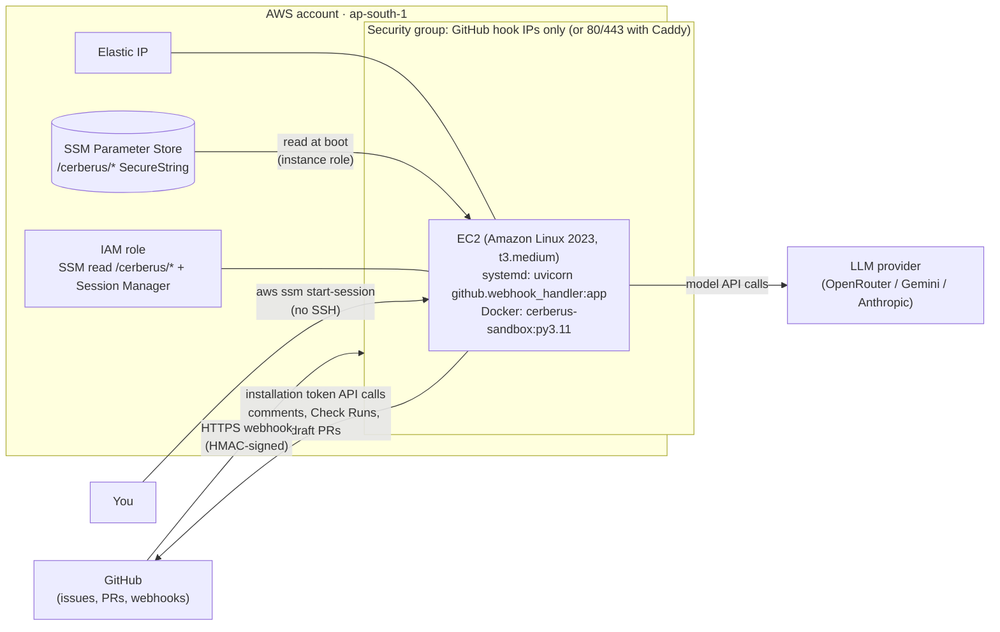

# Deploying Cerberus on AWS

**Status: infrastructure-as-code written and validated in CI; not applied.** No AWS resources have been
created for this project. Everything below is what `terraform apply` would create, and how to run it.

## Architecture



| Resource | Purpose |
| --- | --- |
| EC2 instance (Amazon Linux 2023) | runs the FastAPI GitHub App as a systemd service and Docker for the verification sandbox |
| Elastic IP | stable webhook address |
| Security group | inbound only from GitHub's published webhook IP ranges on port 8000 (or 80/443 when a domain + Caddy HTTPS is configured); no SSH |
| IAM role + instance profile | read only `/cerberus/*` parameters; Session Manager for admin access |
| SSM Parameter Store (created by you) | GitHub App ID, private key, webhook secret, model keys |
| Encrypted gp3 root volume | code, Docker images, repository clones, SQLite run store |

Why EC2 and not Lambda/Fargate: the verification gate starts Docker containers (sandboxed test runs).
That needs a Docker daemon on the host, which serverless platforms do not provide.

Why the App is not itself in a container: it would need the host Docker socket mounted, which is
equivalent to root on the host. Running it under systemd as a dedicated `cerberus` user keeps the sandbox
boundary as it is locally. (Membership of the `docker` group is still powerful; see Security.)

## Files

```
deploy/aws/
├── terraform/
│   ├── versions.tf          # providers, optional S3 backend
│   ├── variables.tf         # region, instance size, git ref, domain, App settings
│   ├── main.tf              # VPC lookup, security group, IAM, EC2, Elastic IP
│   ├── outputs.tf           # public IP, webhook URL, instance id
│   └── user_data.sh.tftpl   # boot script: Docker, Python 3.11, clone, venv, sandbox image, secrets, systemd
└── scripts/
    ├── put-secrets.sh       # store secrets in SSM Parameter Store (prompts; nothing in shell history)
    └── update.sh            # git pull + restart on the instance via SSM Run Command
.github/workflows/deploy-aws.yml   # fmt/validate on every change; manual plan/apply with OIDC
```

## How to deploy (when you have credits)

Prerequisites: an AWS account, AWS CLI v2 configured (`aws configure` or SSO), Terraform ≥ 1.6, the GitHub
App created (App ID, private key `.pem`, webhook secret).

```bash
# 1. secrets -> SSM Parameter Store (SecureString)
cd deploy/aws/scripts
AWS_REGION=ap-south-1 ./put-secrets.sh ~/Downloads/your-app.private-key.pem

# 2. infrastructure
cd ../terraform
terraform init
terraform plan                      # review what will be created
terraform apply                     # creates billable resources
terraform output webhook_url        # paste into the GitHub App's Webhook URL

# 3. check it (no SSH)
aws ssm start-session --target "$(terraform output -raw instance_id)"
#   sudo tail -f /var/log/cerberus-bootstrap.log ; sudo systemctl status cerberus-app
curl "http://$(terraform output -raw public_ip):8000/health"   # only from GitHub IPs unless you add yours

# 4. update to a newer commit later
../scripts/update.sh "$(terraform output -raw instance_id)" upgrade/final

# 5. tear everything down (stops all charges for these resources)
terraform destroy
```

Optional HTTPS: point a DNS name at the Elastic IP and set `-var domain_name=cerberus.example.com`; Caddy
then obtains a certificate and the webhook URL becomes `https://<domain>/webhook`.

From GitHub Actions instead of your laptop: create an IAM role trusted by GitHub's OIDC provider for this
repository, store its ARN as the `AWS_DEPLOY_ROLE_ARN` secret, add required reviewers to the `aws`
environment, then run the "AWS deployment" workflow with `plan` or `apply`.

## Cost

Not measured; this has not been deployed. Main cost drivers: the EC2 instance hours (t3.medium by default;
`t3.micro` fits the AWS Free Tier but is too small for real sandbox runs), the Elastic IP (charged per hour),
EBS storage and outbound data. Use the AWS Pricing Calculator for the chosen region, and run
`terraform destroy` after a demo.

## Security

- Inbound traffic is limited to GitHub's webhook IP ranges (from `https://api.github.com/meta`) unless a
  domain is configured for HTTPS; every webhook is still HMAC-verified by the App.
- No SSH: port 22 is closed; administration is through Session Manager (audited by AWS).
- Secrets are SecureString parameters, read at boot by a role limited to `/cerberus/*`; they never appear in
  Terraform state, user data or the repository. Files on disk are `0640 root:cerberus`.
- IMDSv2 is required and the metadata hop limit is 1, so sandbox containers cannot fetch the instance
  role's credentials.
- The root volume is encrypted; the App runs as an unprivileged user with `NoNewPrivileges`.
- Residual risk: the `cerberus` user is in the `docker` group (needed to start sandbox containers), which
  is root-equivalent on the host. The sandbox containers themselves run offline with all capabilities
  dropped, as locally.

## Scaling path (not implemented)

Move the run store from SQLite to RDS PostgreSQL, put an SQS queue between the webhook handler and
workers, run several worker instances in an Auto Scaling group, and keep the Docker images in ECR.
