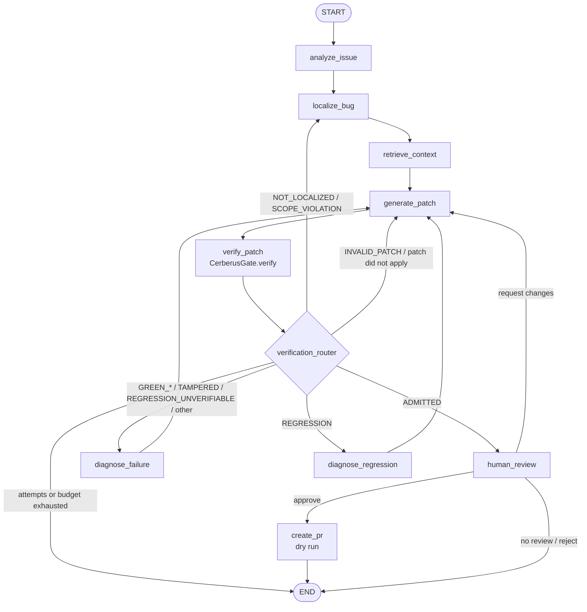

# Phase 3: LangGraph orchestration of the repair loop

`config.orchestrator = "langgraph"` (env `ORCHESTRATOR`, CLI `--orchestrator langgraph`) runs the same bounded
repair as the Phase 1 loop, but as an explicit LangGraph state machine. The default stays `loop`, so Phase 1
behaviour and `repair/interface.py` are unchanged. Code: `autonomous-pr-fixer/repair/orchestration/`.



Any node ends the run (to END) when a budget is hit, with the matching `FinalStatus`.

## State
- `GraphState` (TypedDict, JSON values only): task, analysis, search terms, suspect files, gate-allowed files,
  retrieved context, last gate feedback, diagnosis, review decision, route, final status, workspace diff, and a
  snapshot of the run record.
- `GraphRepairState` extends `RepairState` (agent_run.json) additively: `orchestrator`, `node_history`
  (node, next, timing, attempt, tokens, tool calls), `suspect_files`, `review_decision`, `pr_artifact`, `resumed`.
  `repair/metrics` and `repair/evaluation.py` read it unchanged.

## Nodes
| Node | Model | Tools | Output |
| --- | --- | --- | --- |
| analyze_issue | yes, ≤3 turns | read_test, search_code, record_analysis | analysis, search terms |
| localize_bug | yes, ≤6 turns | read-only (+retrieve_code if retrieval) , record_localization | ≤5 source files, filtered to the gate's allowed files |
| retrieve_context | no | retrieve_code (WorkspaceRetriever, if configured), read_file | context in untrusted-data delimiters |
| generate_patch | yes, until submit | full Phase 1 registry | measured workspace diff |
| verify_patch | no | `RepairAgent._submit` → `CerberusGate.verify` | GateFeedback |
| verification_router | no | – | route |
| diagnose_failure / diagnose_regression | yes, ≤4 turns | read-only, run_test, git_diff, record_diagnosis | diagnosis |
| human_review | no | LangGraph `interrupt` when `--review` | approve / request_changes / reject |
| create_pr | no | – | `pr/PR_BODY.md`, `pr/patch.diff`, `pr/pr.json` (dry run) |

One model serves every node. Prompts: `repair/orchestration/prompts.py` (`GRAPH_PROMPT_VERSION = g1.0`).

## Gate authority and budgets
- Admission comes only from `CerberusGate.verify` (unchanged `main.run_pipeline`). `human_review` and `create_pr`
  re-read the gate's run.json and refuse unless it says ADMITTED; the run end applies the same check. A human
  decision cannot turn a refusal into an admission; rejecting an admitted patch only withholds the PR.
- Every model call checks `RepairAgent._limit_reached` (wall time, tokens, cost, tool calls); every tool call
  checks the tool budget; the router ends at `max_attempts`. Orchestrator reads in retrieve_context and the
  `record_*` calls count as tool calls. Wall time accumulates across resumes.
- Each node opens a tracer span (`Tracer.node`, Langfuse `node:<name>` with model/tool events nested), a JSON log
  line and a `node_history` entry.

## Checkpoints and resume
LangGraph `SqliteSaver` at `<out_root>/langgraph-checkpoints.sqlite` (default `artifacts/repair/`, override
`GRAPH_CHECKPOINT_DB`), thread id = run id, a checkpoint after every node. A node that fails (LLM error,
crash) is not committed; the run ends `LLM_FAILURE`/`ERROR` and is resumable:

```bash
python main.py agent run --repo R --issue "..." --repro-test T --orchestrator langgraph [--review]
python main.py agent resume RUN_ID                          # retry from the last checkpoint
python main.py agent resume RUN_ID --decision approve       # or request_changes --comment ... / reject
python main.py agent evaluate --orchestrator langgraph
```
Resume reopens a fresh workspace, re-applies the checkpointed diff, restores the accounting (the larger of the
checkpoint record and agent_run.json) and continues. Without `--review` an admitted run ends ADMITTED,
awaiting review, with no PR. With `--review` and no terminal, the run stays paused at the checkpoint.

## Limitations
- The patch conversation is not checkpointed (provider-native turns); after a resume generate_patch starts a
  fresh conversation from the explicit state.
- Graph runs spend more model calls than the loop (analysis, localization, diagnosis); no measured comparison yet.
- `create_pr` is a dry run; publishing belongs to the GitHub integration.
- `RepairResult` (interface v1.0) has no review/PR fields; read them from agent_run.json.
- Smoke-tested only with a scripted fake model on the fixture repo; no test suite was added in this phase.
