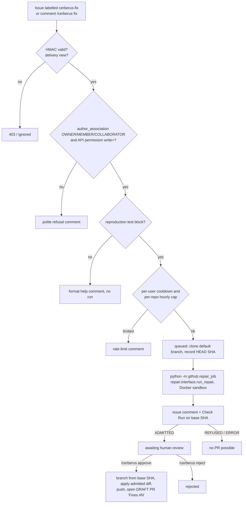

# Phase 4a: issue-triggered repairs in the GitHub App

A maintainer asks Cerberus to fix an issue; the repair agent proposes patches; the
unchanged Cerberus gate decides; a human approves before any pull request exists.



## Commands

| Trigger | Where | Effect |
| --- | --- | --- |
| label `cerberus-fix` | issue | start a repair run |
| `/cerberus fix` | issue comment | start a repair run |
| `/cerberus approve [RUN_ID]` | issue comment | open a draft PR for an ADMITTED run (latest run if no id) |
| `/cerberus reject [RUN_ID] [reason]` | issue comment | mark the run rejected |

Approving a refused or errored run is refused: a human cannot override a failed gate.
Commands on pull requests are ignored. If the default branch moved since the base SHA,
the PR is still opened from the verified base SHA and the comment says so.

States (`issue_runs.status`): queued, running, admitted, refused, error, approved
(approval accepted, PR not yet opened; re-approving retries), rejected, pr_opened.

## Reproduction-test contract

The issue body must contain a fenced ```` ```python ```` block with at least one
`def test_` function (the first such block is used). Template:
`.github/ISSUE_TEMPLATE/cerberus-fix.md`. Without it Cerberus comments the exact format
and starts nothing.

## Report

Issue comment (updated in place) and a Check Run `Cerberus repair (#N)` on the base
commit: run id, final status, gate result with failure stage/code and failed tests,
attempts, model, tokens, estimated cost, retrieval mode and queries, changed files, the
diff in a collapsed block (bounded), base SHA. The Check Run is `success` when admitted
and `neutral` otherwise (a refusal is not a failure of the base commit).

## Security model

- HMAC webhook verification stays mandatory (fails closed without a secret).
- Every command: comment `author_association` in OWNER/MEMBER/COLLABORATOR **and**
  `GET /repos/{o}/{r}/collaborators/{user}/permission` in admin/maintain/write. Label
  events have no association, so the API check decides. Bots are ignored.
- No automatic runs on pull requests from forks (`synchronize`/`reopened` from a fork
  need a fresh `/cerberus verify`). Issue repairs only check out the default branch.
- The repair runs as a subprocess with an allowlisted environment: model settings only,
  never `GITHUB_*` or `CERBERUS_API_TOKEN`; issue text goes through a spec file, not argv.
  Repository code runs only in the Docker sandbox (the App refuses otherwise).
- The installation token is used host-side only: git push via `GIT_CONFIG_*` extraheader
  (pr_publisher), API calls via headers; errors are redacted.
- Published diff = the diff in the admitting gate run.json; publishing re-checks the
  admission evidence and refuses workflow files. PRs are drafts; no auto-merge.
- Repository/model text in comments is fenced as code; comments are size-bounded.
- Rate limits: per-repo hourly cap (`CERBERUS_MAX_RUNS_PER_HOUR`) and a per-user
  cooldown (`CERBERUS_USER_COOLDOWN_SECONDS`), plus idempotent deliveries and per-repo
  serialization (approvals queue behind a running repair in the same repository).

## Setup

GitHub App permissions: Issues read/write, Pull requests read/write, Contents
read/write, Checks read/write, Metadata read. Subscribe to events: Issues, Issue
comment, Pull request. Create the `cerberus-fix` label in the repository.

Environment (server): `GITHUB_APP_ID`, `GITHUB_APP_PRIVATE_KEY` or
`GITHUB_APP_PRIVATE_KEY_PATH`, `GITHUB_WEBHOOK_SECRET`, `CERBERUS_DATA_DIR`,
`CERBERUS_RUN_TIMEOUT_SECONDS`, `CERBERUS_MAX_RUNS_PER_HOUR`,
`CERBERUS_USER_COOLDOWN_SECONDS`, `CERBERUS_RETRIEVAL` (or `RETRIEVAL`), Docker
available, and the model settings (`LLM_PROVIDER`, `LLM_MODEL`, provider key) in the
environment or `autonomous-pr-fixer/.env`.

Not implemented: the optional REST API (`/runs` endpoints); tests for this flow
(skipped on request).
